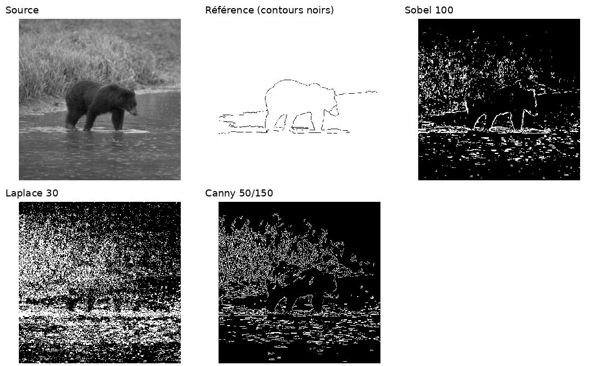

# Détection de contours

Programme C++ qui compare **Sobel, Laplace et Canny**, suivant les consignes de [CONSIGNE.md](CONSIGNE.md). Il permet de régler les paramètres dans une fenêtre et de calculer les mesures sur un lot de 40 images avec leurs références.



## Video

[Regarder la video sur YouTube](https://youtu.be/ftkof2dyRAE).

## Prérequis

- Un compilateur compatible C++17.
- CMake 3.16 ou plus récent.
- OpenCV 4 avec les modules core, imgproc, imgcodecs et highgui, et une session graphique pour l’interface.

## Compilation

```sh
cmake -S . -B build
cmake --build build -j2
```

## Utilisation

```sh
./build/tp_contours --interactive images/bear.pgm
```

Choisir le détecteur et le noyau avec les boutons. Régler les seuils avec les trackbars. Le second seuil agit seulement sur Canny. L’échelle multiplie les valeurs des curseurs ; le bandeau affiche les seuils appliqués. Appuyer sur Échap ou `q` pour quitter.

Pour traiter tout le lot :

```sh
./build/tp_contours --batch images images/gt resultats_sobel sobel 100 150 3
./build/tp_contours --batch images images/gt resultats_laplace laplace 30 150 3
./build/tp_contours --batch images images/gt resultats_canny canny 50 150 3
```

Arguments : images, références, sortie, détecteur, seuil 1, seuil 2, noyau. Le seuil 2 reste dans la commande même s’il est inactif pour Sobel et Laplace. Chaque référence porte le nom `nom_gt_binary.pgm` pour une source `nom.pgm`.

Chaque dossier de sortie contient les contours et `mesures.csv` : les cinq comptes, la performance, le taux de faux positifs et le taux de faux négatifs. Les formules suivent le sujet, avec un voisinage 3×3 sans double comptage.

## Rapport et vidéo

- [Rapport PDF](rapport/rapport.pdf)

Pour reconstruire le PDF, installer Python 3 et une distribution LaTeX avec `pdflatex`, puis lancer `python3 compiler_rapport.py`.
